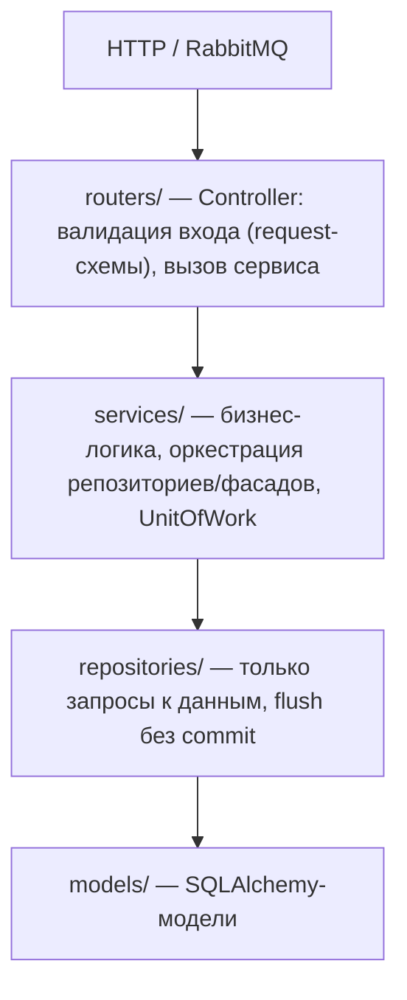
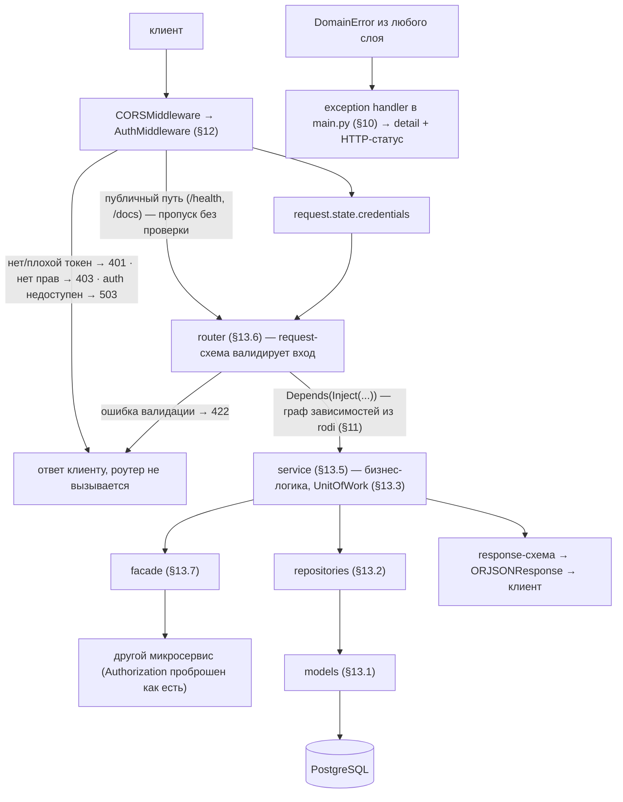
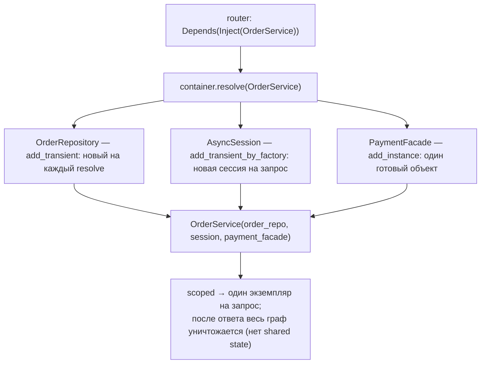
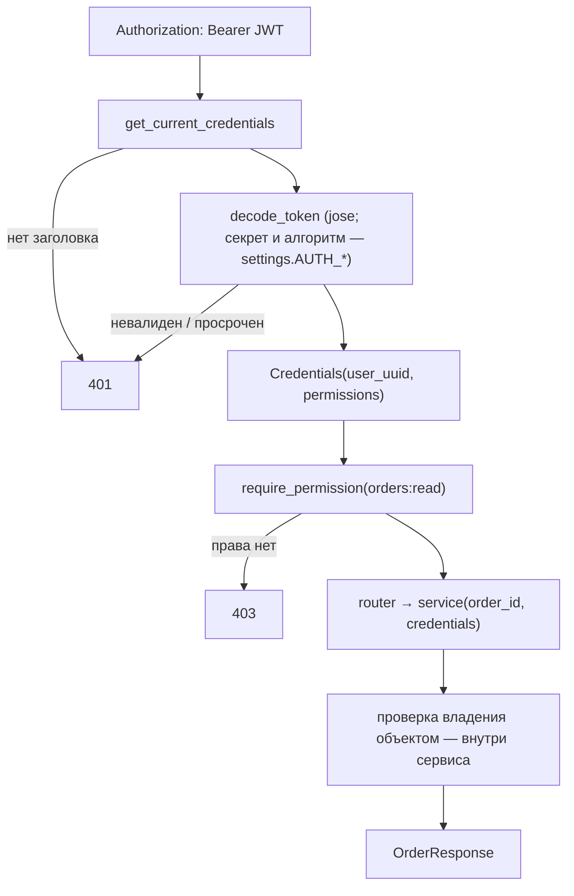
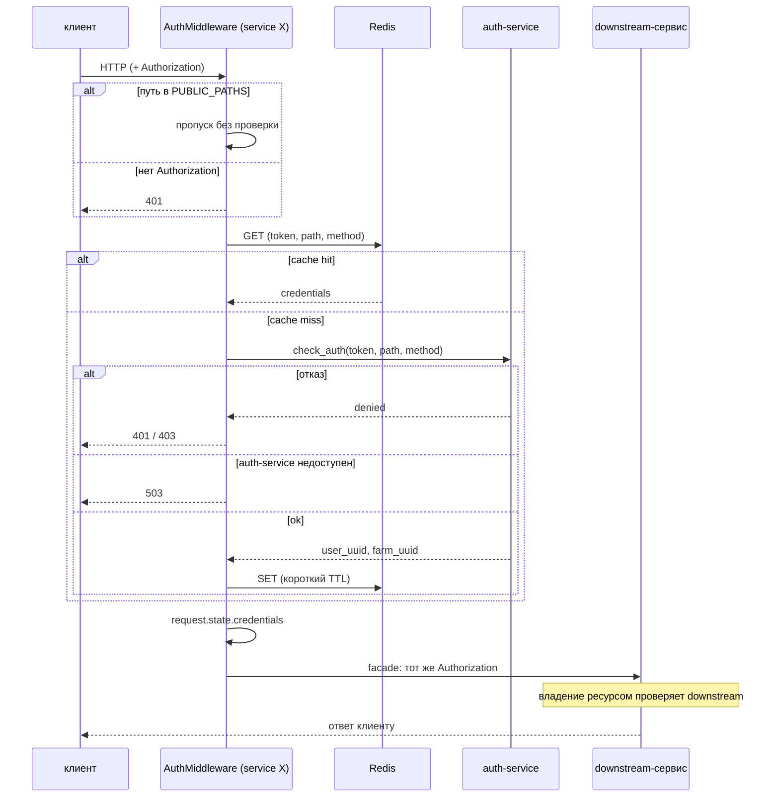
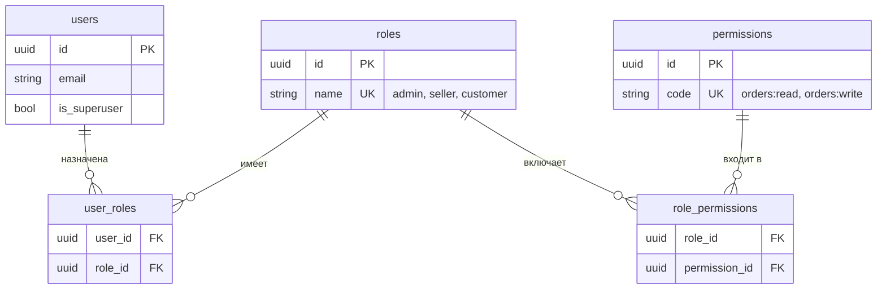
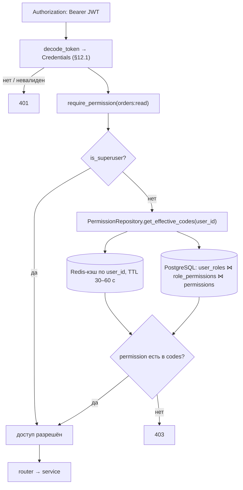
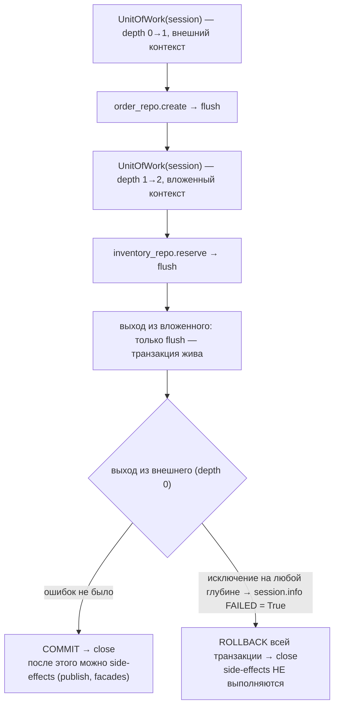
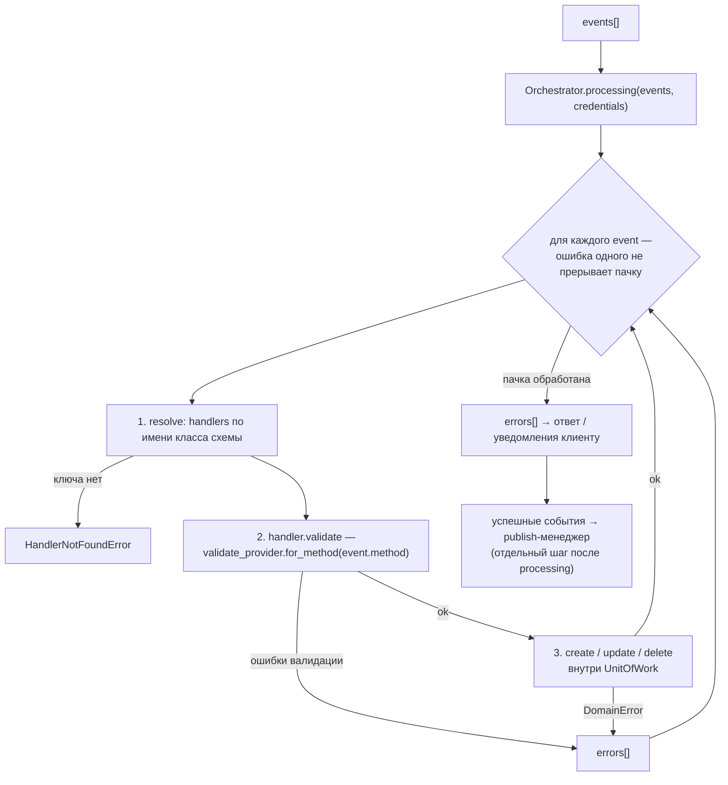

# AGENTS.md — архитектура и правила разработки микросервисов

Единый стандарт, по которому ИИ-агент (или разработчик) создаёт однотипные
FastAPI-микросервисы и новые фичи в существующих. Документ собран по
эталонам:

- `web_milk_back/api/app` — модуль `event` (оркестратор, хендлеры, валидаторы,
  publish), `engines`, `exceptions`, `micro_types`, `settings.py`, `Makefile`,
  `pyproject.toml`, `.pre-commit-config.yaml`;
- `marketplace/README.md` — карта микросервисов и типовая структура сервиса;
- заметка «Rodi в микросервисе Dictionaries API» — канон DI на rodi.

Правила, записанные как **«Правило»**, обязательны. Примеры кода —
канонические: копируется структура, а не доменные имена. Диаграммы — в
формате Mermaid: рендерятся в TUI/Web-интерфейсе Kimi Code, на GitHub и в
IDE с плагином Mermaid.

## 1. Технологический стек

| Категория | Технологии |
|---|---|
| Язык | Python 3.12 |
| Web | FastAPI, uvicorn, Pydantic v2, ORJSON |
| БД | PostgreSQL 16, SQLAlchemy 2.0 (async, `Mapped`/`mapped_column`), Alembic |
| Кэш / очереди | Redis 8, RabbitMQ (FastStream) |
| DI | rodi |
| HTTP-клиенты | httpx / aiohttp (+ backoff для ретраев) |
| Конфигурация | pydantic-settings |
| Качество | ruff (format + lint `ALL`), mypy `--strict`, pre-commit |
| Тесты | pytest, pytest-asyncio |
| Контейнеры | Docker, docker compose |

## 2. Структура проекта

```
service-name/
├── src/
│   ├── main.py              # сборка FastAPI: lifespan, middleware, exception handlers
│   ├── dependencies.py      # глобальный rodi Container (3 строки)
│   ├── depends.py           # init_container(), Inject[T], get_*-провайдеры
│   ├── config/
│   │   └── settings.py      # pydantic-settings, синглтон settings
│   ├── routers/             # HTTP/FastStream-роутеры (тонкие контроллеры)
│   ├── services/            # бизнес-логика, оркестрация, транзакции
│   ├── repositories/        # SQL-запросы, без бизнес-логики и без commit
│   ├── models/              # SQLAlchemy-модели
│   ├── schemes/
│   │   ├── request/         # входные pydantic-схемы
│   │   └── response/        # выходные pydantic-схемы
│   ├── enums/               # StrEnum, один файл на домен
│   ├── micro_types/         # Annotated-алиасы с валидацией
│   ├── exceptions/          # доменные исключения (без FastAPI)
│   ├── engines/             # обёртки над клиентами БД/брокеров/хранилищ/HTTP
│   ├── facades/             # HTTP-клиенты к соседним микросервисам
│   ├── validators/          # прикладные валидаторы + провайдеры
│   ├── core/                # сквозная инфраструктура: logging, http_client, UoW, health
│   └── alembic/             # миграции
├── tests/                   # зеркалит src: services_test/, facades_test/, ...
├── Makefile
├── pyproject.toml
├── .pre-commit-config.yaml
├── Dockerfile
├── .env / example.env
└── README.md
```

Один домен — один файл на слой (`order.py` в `services/`, `repositories/`,
`models/`, `schemes/request/`, `schemes/response/`). Имя файла — snake_case
имя домена; суффиксы классов: `*Service`, `*Repository`, `*Facade`,
`*Engine`, `*Handler`, `*Validator`, `*Publisher`, `*Settings`.
Каждый пакет (директория с `__init__.py`) дополнительно содержит свой
`README.md` с коротким описанием (§5.4).

## 3. Слои и MVC

Архитектура — слоистая MVC:



Побочные каналы (вызываются из services/handlers, не из routers):
`facades/` — HTTP к другим сервисам; `engines/` — инфраструктурные клиенты;
`publish/` — публикация событий; `workers/` — фоновые задачи.

### Поток HTTP-запроса (сквозная схема)



### Разрешённые импорты

| Слой | Может импортировать | Не может |
|---|---|---|
| `routers` | services, schemes, depends, enums, exceptions | repositories, models, engines, facades |
| `services` | repositories, facades, engines, schemes, enums, exceptions, validators | fastapi (`Request`, `HTTPException`, `Response`), models напрямую |
| `handlers` | repositories, validators, schemes, enums, exceptions | routers, fastapi |
| `repositories` | models, enums, core (db) | services, schemes, fastapi |
| `models` | enums, общий `Base` | любой другой слой приложения |
| `schemes` | enums, micro_types, pydantic | models, repositories, services |
| `facades` | engines, schemes, exceptions | services, repositories |
| `validators` | repositories, schemes, exceptions | services, handlers |
| `enums`, `micro_types` | stdlib, pydantic | ничего из приложения |

### Правила непротекания слоёв

1. Роутер не содержит бизнес-логики: извлечь credentials из `request.state`,
   вызвать один метод сервиса, вернуть response-схему.
2. Сервис не импортирует FastAPI. Ошибки — доменные исключения; маппинг в
   HTTP-статусы выполняется только в `main.py`.
3. Репозиторий получает `session` явным параметром и делает `flush`;
   `commit`/`rollback` — только в `UnitOfWork` на уровне сервиса/хендлера.
4. Наружу из сервиса уходят только response-схемы — не SQLAlchemy-модели
   и не сырые dict с полями модели.
5. Хендлеры оркестратора никто не импортирует напрямую, кроме `depends.py`
   (реестр) — связь только через реестр менеджера.

## 4. Принципы

### 4.1 Явное лучше неявного

- Зависимости — явные аннотированные параметры `__init__`. Вызов
  `container.resolve()` внутри класса — service locator, анти-паттерн.
- `session` — явный первый параметр каждого метода репозитория.
- Полные аннотации типов в сигнатурах — обязательны (mypy `--strict`).
- Регистрация зависимостей, хендлеров, паблишеров — явная, в одном месте
  (`depends.py` / реестр-константа).
- Динамический диспатч (`getattr(handler, event.method)`) допустим только в
  оркестраторе и должен быть задокументирован в его классе.
- Никакого чтения `os.environ` вне `settings.py`.

### 4.2 Слабая связанность

- Слои общаются через абстракции на границах: `BaseRepository[T, AS]`,
  `BaseHandler`, `BasePublisher`, `BaseClient`.
- Класс не создаёт свои зависимости (`self.x = SomeService()` — запрещено);
  их передаёт DI-контейнер через конструктор.
- Сервисы и хендлеры не хранят состояние запроса в `self` (scoped-сессия
  через DI — единственное допустимое исключение).
- Общий код выносится в базовые классы/утилиты, а не копируется.

### 4.3 Единообразие

Новый код повторяет каноны этого документа: структуру файлов, форму
`__init__.py`, оформление схем, исключений, регистрации в DI. Если канон не
подходит — сначала обсуждается изменение канона, потом код.

## 5. Файловые соглашения

### 5.1 Запрет описания в начале py-файла

**Правило.** В начало `.py`-файла не добавляется docstring с описанием
модуля. Первое содержимое файла — импорты. Назначение модуля читается из
его имени, структуры пакета, `README.md` пакета (§5.4) и этого документа.
Поясняющие комментарии («почему», а не «что») допустимы рядом с
нетривиальным кодом.

### 5.2 `__init__.py` и `__all__`

**Правило.** Каждый пакет делает плоский реэкспорт публичных имён и объявляет
явный `__all__`. Потребители импортируют из пакета, а не из файла:
`from src.services import OrderService`, а не
`from src.services.order_service import OrderService`.

```python
# src/services/__init__.py
from .order_service import OrderService
from .storefront_service import StorefrontService

__all__ = [
    "OrderService",
    "StorefrontService",
]
```

Если пакет пока ничего не экспортирует — `__init__.py` содержит явный
`__all__ = []`. Исключения: корневой `src/__init__.py` (пустой),
`routers/__init__.py` (собирает `include_router` — это его публичная роль).

### 5.3 Именование

- Файлы — snake_case по имени домена: `weighing.py`, `order.py`.
- Классы — CamelCase с суффиксом слоя: `WeighingRepository`,
  `OrderService`, `PaymentFacade`.
- Схемы запросов — глагол + сущность: `CreateOrderRequest`,
  `UpdateEventWeighing`; ответов — сущность + `Response`: `OrderResponse`.
- Enum-члены — UPPER_SNAKE, значения — стабильные строки из внешнего
  контракта.

### 5.4 README.md в каждом пакете

**Правило.** Каждый пакет (директория с `__init__.py`) содержит `README.md`
с коротким описанием: назначение пакета (1–3 предложения), основные экспорты
и нестандартные соглашения пакета, если они есть. Описание пакета живёт в его
`README.md` — не в docstring файлов (§5.1).

Шаблон:

```markdown
# services

Бизнес-логика сервиса. Один файл на домен (`order_service.py`). Классы не
импортируют FastAPI, ошибки — доменные исключения из `src.exceptions`,
транзакции — через `UnitOfWork`.

Экспорты (`__all__`): `OrderService`, `StorefrontService`.
```

- `README.md` обновляется в том же коммите, что и изменение пакета.
- Коротко: назначение + экспорты + специфика. Содержимое AGENTS.md целиком
  не дублируется.
- Относится и к пакетам `src/`, и к подпакетам `tests/`.

## 6. Микротипы

Микротип — `typing.Annotated` с pydantic-ограничениями: валидация зашита в
сам тип и срабатывает в любой схеме, где он использован.

```python
# src/micro_types/animal.py
from typing import Annotated
from uuid import UUID

from pydantic import StringConstraints

AnimalUUID = Annotated[UUID, None]
NumberInv = Annotated[
    str, StringConstraints(strip_whitespace=True, min_length=1, pattern=r"^\d+$")
]
```

```python
# src/micro_types/__init__.py
from .animal import AnimalUUID, NumberInv

__all__ = ["AnimalUUID", "NumberInv"]
```

Правила:

- Микротип не содержит логики — только тип и ограничения.
- Используется в схемах и сигнатурах вместо голых `str`/`int`/`UUID`, когда у
  значения есть инвариант (формат, обрезка пробелов, диапазон).
- Каждый новый микротип сразу добавляется в `__init__.py` и `__all__` —
  в эталоне встречались файлы, забытые в реэкспорте; это считается ошибкой.

## 7. Enums

```python
# src/enums/order.py
from enum import StrEnum


class OrderStatus(StrEnum):
    PENDING = "pending"
    CONFIRMED = "confirmed"
    PAID = "paid"
    CANCELLED = "cancelled"
```

Правила:

- Строковые enum — `StrEnum`; значения — часть внешнего контракта
  (БД, JSON API, RabbitMQ), меняются только с миграцией контракта.
- Один файл на домен; плоский реэкспорт через `enums/__init__.py` с `__all__`.
- Enums — нижний слой: не импортируют ничего из приложения, импортируются
  всеми.

## 8. Настройки (`config/settings.py`)

pydantic-settings: вложенные `BaseSettings` с собственным `env_prefix`,
корневой `Settings`, синглтон на импорте модуля.

```python
# src/config/settings.py
from pydantic_settings import BaseSettings, SettingsConfigDict


class RedisSettings(BaseSettings):
    model_config = SettingsConfigDict(env_prefix="REDIS_")

    HOST: str = "localhost"
    PORT: int = 6379
    DB: int = 0

    @property
    def url(self) -> str:
        return f"redis://{self.HOST}:{self.PORT}/{self.DB}"


class AuthSettings(BaseSettings):
    model_config = SettingsConfigDict(env_prefix="AUTH_")

    URL: str = "http://127.0.0.1:8110"
    APP_ID: str = "SERVICE"
    TIMEOUT: float = 10.0


class Settings(BaseSettings):
    model_config = SettingsConfigDict(
        env_file=".env", env_file_encoding="utf-8", extra="ignore"
    )

    APP_NAME: str = "service-name"
    APP_PORT: int = 8000
    LOG_LEVEL: str = "info"

    redis: RedisSettings = RedisSettings()
    auth: AuthSettings = AuthSettings()


settings = Settings()
```

Правила:

- Дефолты — только безопасные dev-значения. Секреты, пароли, реальные хосты
  не хардкодятся: пустой дефолт + `.env` + `example.env` в репозитории
  (в эталоне встречались реальные креды в дефолтах — это анти-паттерн).
- Каждая подсистема — свой класс с префиксом (`REDIS_`, `AUTH_`, `S3_`).
- Вычисляемые значения (DSN, URL) — `@property`, а не дублирование полей.
- Валидация — типами pydantic; для составных правил — `model_validator`.
- `settings` — единственная точка чтения конфигурации в приложении.

## 9. Engines

Engine — обёртка над клиентом инфраструктуры (БД, Redis, S3, RabbitMQ,
HTTP). Не содержит бизнес-логики и не знает о доменных схемах.

```python
# src/engines/base.py
from typing import Self

from httpx import AsyncClient, Limits, Timeout


class BaseClient:
    def __init__(
        self,
        base_url: str = "",
        timeout: float = 10.0,
        max_connections: int = 100,
        max_keepalive_connections: int = 20,
    ) -> None:
        self.base_url = base_url
        self.client = AsyncClient(
            base_url=self.base_url,
            timeout=Timeout(timeout=timeout),
            limits=Limits(
                max_connections=max_connections,
                max_keepalive_connections=max_keepalive_connections,
            ),
        )

    async def __aenter__(self) -> Self:
        return self

    async def __aexit__(self, exc_type, exc_val, exc_tb) -> None:
        await self.client.aclose()
```

```python
# src/engines/postgres_storage.py
class PostgresEngine:
    def __init__(self, session_factory: Callable[[], AsyncSession]) -> None:
        self._session_factory = session_factory

    async def execute(self, stmt, *, return_many: bool = False):
        async with self._session_factory() as session:
            cursor = await session.execute(stmt)
            if return_many:
                return cursor.scalars().all()
            return cursor.scalar_one_or_none()
```

Правила:

- Конфигурация — параметрами конструктора; конкретные значения подставляются
  из `settings` при регистрации в DI.
- Движок с жизненным циклом соединения — async context manager
  (`__aenter__`/`__aexit__`).
- Контракт ошибок един для движка и зафиксирован в его классе: либо
  исключение наружу (предпочтительно — конвертация в доменную ошибку на
  уровне сервиса), либо лог + `None`. Молчаливое проглатывание
  (`except Exception: log` без возврата/проброса) запрещено.
- Регистрация: `container.add_instance(...)` для готовых клиентов или
  фабрика для сессий.

## 10. Пользовательские исключения

**Правило.** Доменные исключения не зависят от FastAPI. Маппинг в
HTTP-статусы выполняется только в `main.py` через exception handlers.
`fastapi.HTTPException` вне `main.py`/middleware не импортируется.

```python
# src/exceptions/base.py
class DomainError(Exception):
    """Базовое доменное исключение."""


class NotFoundError(DomainError):
    """Ресурс не найден → 404."""


class ValidationError(DomainError):
    """Невалидный вход → 400."""


class UnauthorizedError(DomainError):
    """Требуется аутентификация → 401."""


class ForbiddenError(DomainError):
    """Недостаточно прав → 403."""


class ServiceUnavailableError(DomainError):
    """Недоступен зависимый сервис → 503."""
```

Доменные исключения — в файлах по доменам, наследуются от базовых:

```python
# src/exceptions/order.py
from .base import NotFoundError


class OrderNotFoundError(NotFoundError):
    def __init__(self, order_id: str) -> None:
        super().__init__(f"Order {order_id} not found")
```

```python
# src/exceptions/__init__.py
from .base import (
    DomainError,
    ForbiddenError,
    NotFoundError,
    ServiceUnavailableError,
    UnauthorizedError,
    ValidationError,
)
from .order import OrderNotFoundError

__all__ = [
    "DomainError",
    "ForbiddenError",
    "NotFoundError",
    "OrderNotFoundError",
    "ServiceUnavailableError",
    "UnauthorizedError",
    "ValidationError",
]
```

Маппинг — в `main.py`:

```python
@app.exception_handler(DomainError)
async def domain_error_handler(request: Request, exc: DomainError) -> ORJSONResponse:
    status_map: dict[type[DomainError], int] = {
        NotFoundError: 404,
        ValidationError: 400,
        UnauthorizedError: 401,
        ForbiddenError: 403,
        ServiceUnavailableError: 503,
    }
    status_code = status_map.get(type(exc), 500)
    return ORJSONResponse(status_code=status_code, content={"detail": str(exc)})
```

Правила:

- Исключения выбрасываются в сервисах, хендлерах, валидаторах; ловятся
  централизованно в `main.py`.
- Сообщение исключения — клиентский `detail`: понятный текст без внутренних
  деталей инфраструктуры (строки подключения, трейсы SQL).
- Обязательны обработчики для: доменных ошибок, ошибок downstream-фасадов
  (4xx пробрасывается как есть, 5xx → собственный 503), и catch-all
  `Exception` → 500 без утечки деталей.
- Вариант с уведомлениями (из эталона `web_milk_back`): исключение несёт
  `trigger: Trigger` (StrEnum) и умеет `notify(user_uuid)` через
  `NotificationFacade` — применять только если сервис реально шлёт
  уведомления; базовый класс всё равно не должен тянуть HTTP в домен.

## 11. Внедрение зависимостей (rodi)

Три элемента: глобальный контейнер, модуль регистрации, мост в FastAPI.

```python
# src/dependencies.py
from rodi import Container

container = Container()
```

```python
# src/depends.py
from src.dependencies import container


class Inject[T]:
    """FastAPI-зависимость: резолвит сервис из rodi-контейнера."""

    __slots__ = ("_service",)

    def __init__(self, service: type[T]) -> None:
        self._service = service

    def __call__(self) -> T:
        return container.resolve(self._service)


def init_container() -> None:
    container.add_instance(settings, Settings)

    container.add_instance(
        OrderFacade(base_url=settings.ORDER_SERVICE_URL), OrderFacade
    )
    container.add_transient(OrderRepository)
    container.add_transient_by_factory(
        lambda: ServiceSessionMaker(), return_type=ServiceAsyncSession
    )
    container.add_scoped(OrderService)
```

`init_container()` вызывается один раз в `lifespan`:

```python
@asynccontextmanager
async def lifespan(app: FastAPI):
    init_container()
    yield
```

Время жизни регистраций:

| Регистрация | Семантика | Для чего |
|---|---|---|
| `add_instance` | готовый объект | settings, engines, фасады, менеджер оркестратора |
| `add_singleton` / `*_by_factory` | один экземпляр | клиенты без состояния запроса |
| `add_scoped` | экземпляр на область (в текущей связке ведёт себя как transient — допустимо, т.к. сервисы не хранят состояние) | сервисы, хендлеры |
| `add_transient` | новый экземпляр на каждый resolve | репозитории, сессии |

Использование в роутере:

```python
service: Annotated[OrderService, Depends(Inject(OrderService))]
```

Жизненный цикл запроса (гарантии изоляции):

1. FastAPI вызывает `Inject(...)` / фабрику `get_*`.
2. Контейнер создаёт новую сессию (transient), новые репозитории, новый
   сервис — со всеми зависимостями по аннотациям `__init__`.
3. После ответа объекты уничтожаются: нет shared state между запросами,
   async-безопасность по построению.

Схема резолюции зависимостей на запрос:



Правила:

- Вся регистрация — в одном `init_container()`; новый класс, участвующий в
  DI, регистрируется там же, в коммите с его созданием.
- Класс объявляет все зависимости в аннотированном `__init__` — rodi
  резолвит граф автоматически. `container.resolve()` внутри классов
  запрещён (см. §18).
- `Inject` не поддерживает async-генераторы: сессии с `yield` подключаются
  обычной generator-dependency (`get_service_session`) напрямую.
- Альтернатива `Inject` — фабрика `get_order_service() -> OrderService`;
  выбирается один стиль на сервис и применяется последовательно.

## 12. Аутентификация, авторизация и проверка прав

Термины: **аутентификация** — кто вызывает; **авторизация** (проверка
прав) — что ему разрешено. Семантика статусов едина для всех вариантов:
`401` — личность не подтверждена (токен отсутствует, невалиден или
просрочен); `403` — личность подтверждена, но права не хватает. В коде это
доменные `UnauthorizedError` / `ForbiddenError` с маппингом в `main.py`
(§10). Три канона: два для монолита (локальный JWT — §12.1, RBAC с правами
в БД — §12.3) и один для микросервиса (§12.2).

### 12.1 Монолит: локальная проверка JWT

Применяется, когда сервис сам выпускает токены или разделяет секрет с
выпускающим. Токен декодируется локально (python-jose), секрет и алгоритм —
из `settings` (`AUTH_*`).

Поток проверки:



```python
# src/core/security.py
from dataclasses import dataclass
from uuid import UUID

from jose import JWTError, jwt

from src.config.settings import settings
from src.exceptions import UnauthorizedError


@dataclass(frozen=True, slots=True)
class Credentials:
    user_uuid: UUID
    permissions: set[str]


def decode_token(token: str) -> Credentials:
    try:
        payload = jwt.decode(
            token, settings.auth.SECRET_KEY, algorithms=[settings.auth.ALGORITHM]
        )
    except JWTError as exc:
        raise UnauthorizedError("Invalid or expired token") from exc
    return Credentials(
        user_uuid=UUID(payload["sub"]),
        permissions=set(payload.get("permissions", [])),
    )
```

Проверки оформляются dependencies, а не кодом в теле роутера:

```python
# src/depends.py
def get_current_credentials(request: Request) -> Credentials:
    token = request.headers.get("Authorization", "").removeprefix("Bearer ")
    if not token:
        raise UnauthorizedError("Missing token")
    return decode_token(token)


def require_permission(permission: str) -> Callable:
    def checker(
        credentials: Annotated[Credentials, Depends(get_current_credentials)],
    ) -> Credentials:
        if permission not in credentials.permissions:
            raise ForbiddenError(f"Permission denied: {permission}")
        return credentials

    return checker
```

```python
# src/routers/orders.py
@router.get("/{order_id}", summary="Карточка заказа")
async def get_order(
    order_id: UUID,
    credentials: Annotated[Credentials, Depends(require_permission("orders:read"))],
    service: Annotated[OrderService, Depends(Inject(OrderService))],
) -> OrderResponse:
    return await service.get_order(order_id, credentials)
```

Правила:

- Грубая авторизация (RBAC: роль → набор permissions) — в dependencies;
  доменная проверка владения («этот заказ принадлежит этому пользователю») —
  в сервисном слое.
- Токен валидируется на каждый запрос; локального кэша валидности нет.
- Сервис получает `credentials` явным параметром и не трогает `Request`.

### 12.2 Микросервис: делегирование auth-сервису

Применяется в экосистеме с отдельным auth-service (marketplace, milk).
Сервис **не декодирует токен**: middleware вызывает auth-service
(`/v1/auth/check_credentials` с token + path + method), кеширует результат в
Redis (ключ — токен + path + method, короткий TTL) и кладёт credentials в
`request.state`.

Схема проверки:



```python
# src/auth_middleware.py
from dataclasses import dataclass
from uuid import UUID

from fastapi import Request, Response
from fastapi.responses import ORJSONResponse
from starlette.middleware.base import BaseHTTPMiddleware

from src.exceptions import ServiceUnavailableError

PUBLIC_PATHS = ("/health", "/docs", "/redoc", "/openapi.json")


@dataclass(frozen=True, slots=True)
class Credentials:
    token: str
    user_uuid: UUID
    farm_uuid: UUID


class AuthMiddleware(BaseHTTPMiddleware):
    async def dispatch(self, request: Request, call_next) -> Response:
        if request.url.path in PUBLIC_PATHS:
            return await call_next(request)
        token = request.headers.get("Authorization")
        if not token:
            return ORJSONResponse(status_code=401, content={"detail": "Auth failed"})
        try:
            auth_result = await request.app.state.auth_client.check_auth(
                token=token, path=request.url.path, method=request.method
            )
        except ServiceUnavailableError:
            return ORJSONResponse(
                status_code=503, content={"detail": "Auth service unavailable"}
            )
        if auth_result is None:
            return ORJSONResponse(status_code=401, content={"detail": "Auth failed"})
        request.state.credentials = Credentials(
            token=token,
            user_uuid=auth_result.user_uuid,
            farm_uuid=auth_result.farm_uuid,
        )
        return await call_next(request)
```

Правила:

- Публичные пути (`/health`, `/docs`, `/openapi.json`) исключены из
  middleware явным списком.
- Auth-service недоступен → `503` (fail closed); токен отклонён → `401`;
  право на path/method отсутствует → `403`. Не смешивать: недоступность
  auth-service — это не `401`.
- `AuthClient` — фасад (`facades/auth.py`) на базе `BaseClient` (§9),
  создаётся в `lifespan` и кладётся в `app.state`.
- Роутер читает credentials из `request.state` и передаёт сервису явным
  параметром (§13.6); ручной разбор токена в роутере запрещён.
- Фасады пробрасывают `Authorization` вызывающего как есть (§13.7):
  проверку владения ресурсом выполняет downstream-сервис, BFF не решает,
  чей это заказ.
- Дополнительные контекстные проверки — отдельные dependencies (паттерн
  `check_farm_permission` из эталона: заголовок `farms` сверяется с
  `credentials.farm_uuid`, несовпадение → `403`).
- Кэш проверок обязателен: без него каждый запрос дублируется вызовом в
  auth-service. TTL короткий (секунды–минуты); инвалидация при logout —
  ответственность auth-service.

### 12.3 Монолит: RBAC с правами в базе данных

Развитие §12.1: токен проверяется локально, но роли и разрешения **не
зашиты в код и не вложены в JWT** — они хранятся в БД и читаются при
проверке. Права меняются административными операциями над таблицами: без
деплоя, без перевыпуска токенов, отзыв роли действует немедленно (или с
задержкой TTL кэша).

Модель данных (пользователи → роли → разрешения):



DDL (PostgreSQL; таблицы `roles`, `permissions`, связки m2m; `users` уже
существует):

```sql
CREATE TABLE roles (
    id   uuid PRIMARY KEY DEFAULT gen_random_uuid(),
    name varchar(64) NOT NULL UNIQUE
);

CREATE TABLE permissions (
    id   uuid PRIMARY KEY DEFAULT gen_random_uuid(),
    code varchar(128) NOT NULL UNIQUE  -- "resource:action", напр. orders:read
);

CREATE TABLE user_roles (
    user_id uuid NOT NULL REFERENCES users(id) ON DELETE CASCADE,
    role_id uuid NOT NULL REFERENCES roles(id) ON DELETE CASCADE,
    PRIMARY KEY (user_id, role_id)
);

CREATE TABLE role_permissions (
    role_id       uuid NOT NULL REFERENCES roles(id) ON DELETE CASCADE,
    permission_id uuid NOT NULL REFERENCES permissions(id) ON DELETE CASCADE,
    PRIMARY KEY (role_id, permission_id)
);
```

Код разрешения — строка `"resource:action"` (`orders:read`,
`catalog:write`). Реестр допустимых кодов заводится seed-миграцией Alembic
(`make db.revision m="seed rbac permissions"`); новый код разрешения в коде
= новая миграция с его `INSERT`.

Эффективные права пользователя — один запрос через JOIN:

```sql
SELECT DISTINCT p.code
FROM user_roles ur
JOIN role_permissions rp ON rp.role_id = ur.role_id
JOIN permissions p       ON p.id = rp.permission_id
WHERE ur.user_id = :user_id;
```

Реализация — репозиторий + dependency (модели `UserRole`,
`RolePermission`, `Permission` — обычные модели §13.1):

```python
# src/repositories/permission.py
class PermissionRepository:
    async def get_effective_codes(
        self, session: ServiceAsyncSession, user_id: UUID
    ) -> set[str]:
        stmt = (
            select(Permission.code)
            .join(RolePermission, RolePermission.permission_id == Permission.id)
            .join(UserRole, UserRole.role_id == RolePermission.role_id)
            .where(UserRole.user_id == user_id)
            .distinct()
        )
        result = await session.execute(stmt)
        return set(result.scalars().all())
```

```python
# src/depends.py
def require_permission(permission: str) -> Callable:
    async def checker(
        credentials: Annotated[Credentials, Depends(get_current_credentials)],
        session: Annotated[ServiceAsyncSession, Depends(get_service_session)],
        repo: Annotated[PermissionRepository, Depends(Inject(PermissionRepository))],
    ) -> Credentials:
        if credentials.is_superuser:
            return credentials
        codes = await repo.get_effective_codes(session, credentials.user_uuid)
        if permission not in codes:
            raise ForbiddenError(f"Permission denied: {permission}")
        return credentials

    return checker
```

Поток проверки:



Правила:

- Права — данные, а не код: связки роль ↔ разрешение меняются только
  миграциями и админ-операциями над таблицами. В JWT кладётся только
  идентичность (`sub`, `is_superuser`): список прав в токене устаревает до
  его истечения.
- `Credentials` (§12.1) дополняется флагом `is_superuser`; обход проверки —
  только через этот явный флаг, «тихих» суперпользователей быть не должно.
- Код разрешения в `require_permission(...)` — точка привязки кода к
  контракту; это нормально. Данные (кто обладает правом) — всегда в БД.
- Запрос прав кэшируется в Redis (ключ — `user_id`, TTL 30–60 с); при
  изменении ролей пользователя кэш инвалидируется той же операцией записи,
  а не дожидается TTL.
- Таблицы RBAC живут в схеме сервиса-владельца идентичности; доступ к ним —
  только через `PermissionRepository`, прямых запросов из других слоёв нет.
- Группы (`user_groups` → `group_roles`) вводятся тем же паттерном, когда
  ручное назначение ролей перестаёт масштабироваться, и не раньше (YAGNI).

### 12.4 Общие правила

- `Credentials` — неизменяемый объект (frozen dataclass / pydantic); живёт
  в `request.state` или передаётся параметром; никогда — в `self` сервиса.
- BFF/прокси-сервис токен не декодирует и не верифицирует локально вообще —
  только пробрасывает downstream.
- Проверки прав не размазываются по слоям: грубая авторизация
  (path/method или permission) — middleware/dependency; владение объектом —
  сервис; межсервисная — downstream.
- Список публичных путей — явный и минимальный; новый публичный эндпоинт —
  осознанное решение, зафиксированное в коде списка.

## 13. Каноны слоёв

### 13.1 Модели

```python
# src/models/order.py
from uuid import UUID

from sqlalchemy import Index
from sqlalchemy.orm import Mapped, mapped_column

from src.core.database import Base
from src.enums import OrderStatus


class Order(Base):
    __tablename__ = "order"
    __table_args__ = (
        Index(None, "user_uuid", "status"),
        {"schema": "orders", "comment": "Заказ"},
    )

    user_uuid: Mapped[UUID]
    status: Mapped[OrderStatus]
    total: Mapped[int]
    is_delete: Mapped[bool] = mapped_column(default=False)
```

Правила:

- Только SQLAlchemy 2.0-стиль: `Mapped`/`mapped_column`.
- Наследование от общего `Base` (id, `created_at`, `updated_at`,
  naming-convention для `ix_/uq_/ck_/fk_/pk_`).
- Схема БД = имя сервиса (`{"schema": "orders"}`) — изоляция схем между
  микросервисами.
- Soft-delete через `is_delete`, когда требуется историчность.
- Модели не содержат бизнес-методов; `@property` для вычислимых
  производных (например, `event_type`) допустимы.
- Изменение модели = миграция Alembic в том же коммите.

### 13.2 Репозитории

```python
# src/repositories/order.py
from sqlalchemy import and_, select

from src.core.database import BaseRepository, ServiceAsyncSession
from src.models import Order


class OrderRepository(BaseRepository[Order, ServiceAsyncSession]):
    def __init__(self) -> None:
        super().__init__(Order)

    async def get_open_by_user(
        self, session: ServiceAsyncSession, user_uuid: UUID
    ) -> list[Order]:
        stmt = select(self.model).where(
            and_(
                self.model.user_uuid == user_uuid,
                self.model.is_delete.is_(False),
            )
        )
        result = await session.execute(stmt)
        return list(result.scalars().all())
```

Правила:

- Generic-база `BaseRepository[T, AS]` с CRUD (`get_by`, `create`,
  `update`, `delete`, `bulk_create`, `get_paginated_multi`); конкретный
  репозиторий добавляет только специфичные запросы.
- `session` — явный первый параметр каждого метода.
- `create`/`update`/`delete` делают только `flush`; граница транзакции —
  `UnitOfWork` в сервисе/хендлере (§13.3).
- Бизнес-правила в репозитории запрещены — только выборки и записи.
- `.is_(False)` вместо `== False` в SQL-выражениях.

### 13.3 Сессии, транзакции и UnitOfWork

**Создание сессий.** Engine и фабрика сессий — в `src/core/database.py`:

```python
# src/core/database.py
from sqlalchemy.ext.asyncio import async_sessionmaker, create_async_engine

from src.config.settings import settings

engine = create_async_engine(
    settings.postgres.URI,
    pool_size=settings.postgres.POOL_SIZE,
    pool_pre_ping=True,
)
ServiceSessionMaker = async_sessionmaker(engine, expire_on_commit=False)
```

Два канонических способа выдачи сессии:

```python
# 1. generator-dependency — для роутеров
#    (Inject async-генераторы не поддерживает, §11)
async def get_service_session() -> AsyncGenerator[AsyncSession, None]:
    async with ServiceSessionMaker() as session:
        yield session

# 2. фабрика в контейнере — для сервисов/хендлеров
container.add_transient_by_factory(
    lambda: ServiceSessionMaker(), return_type=AsyncSession
)
```

Правила сессий:

- Сессия не создаётся вручную — только через DI-фабрику или
  generator-dependency.
- Одна сессия на запрос/задачу; между запросами не переиспользуется; в `self`
  вне DI-управляемого времени жизни не сохраняется.
- `expire_on_commit=False` — загруженные объекты остаются пригодными после
  коммита.
- Репозитории получают сессию явным параметром (§13.2), а не из глобального
  состояния.

**UnitOfWork и механизм отката.** Граница транзакции — контекст-менеджер со
счётчиком глубины и флагом ошибки в `session.info`:

```python
# src/core/uow.py
class UnitOfWork:
    DEPTH_KEY = "uow_depth"
    FAILED_KEY = "uow_failed"

    def __init__(self, session: AsyncSession) -> None:
        self._session = session

    async def __aenter__(self) -> AsyncSession:
        depth = self._session.info.get(self.DEPTH_KEY, 0)
        self._session.info[self.DEPTH_KEY] = depth + 1
        return self._session

    async def __aexit__(self, exc_type, exc_val, exc_tb) -> None:
        depth = self._session.info[self.DEPTH_KEY] - 1
        self._session.info[self.DEPTH_KEY] = depth
        if exc_type is not None:
            self._session.info[self.FAILED_KEY] = True
        if depth > 0:
            await self._session.flush()
            return
        if self._session.info.pop(self.FAILED_KEY, False):
            await self._session.rollback()
        else:
            await self._session.commit()
        await self._session.close()
```

```python
# использование — в сервисе/хендлере
async with UnitOfWork(self.service_session) as session:
    order = await self.order_repo.create(session=session, ...)
    await self.inventory_repo.reserve(session=session, ...)
```

Схема жизни транзакции:



Семантика:

- Внешний (глубина 0) контекст владеет транзакцией: `commit` при успехе,
  `rollback` при ошибке, `close` в конце.
- Вложенные контексты делают только `flush`: промежуточное состояние видно
  всем участникам, транзакция остаётся единой.
- Исключение на любой глубине помечает сессию `FAILED` — внешний уровень
  гарантированно откатывает всё, даже если исключение было перехвачено
  внутри.
- Откат полный: частичного «коммита того, что успели» не бывает — иначе
  рассинхрон между агрегатами.

Правила:

- UnitOfWork открывается в сервисе/хендлере, никогда — в репозитории;
  `commit`/`rollback` вне UnitOfWork запрещены.
- Side-effects (publish, вызовы фасадов) — только после успешного выхода из
  UnitOfWork: после `rollback` внешний мир трогать нельзя (§14.3).
- Внешние вызовы (HTTP, брокер) внутри транзакции запрещены: длинная
  транзакция держит блокировки и соединение из пула.

### 13.4 Схемы

```
src/schemes/
├── __init__.py          # __all__ = [...]
├── request/
│   ├── __init__.py
│   └── order.py
└── response/
    ├── __init__.py
    └── order.py
```

Request — входная валидация:

```python
# src/schemes/request/order.py
from pydantic import BaseModel, Field, field_validator

from src.micro_types import Comment


class CreateOrderRequest(BaseModel):
    items: list[OrderItemRequest] = Field(
        description="Позиции заказа.", min_length=1
    )
    comment: Comment = ""

    @field_validator("items")
    @classmethod
    def unique_products(cls, value: list[OrderItemRequest]) -> list[OrderItemRequest]:
        ...
        return value
```

Response — контракт ответа, каждое поле документировано:

```python
# src/schemes/response/order.py
class OrderResponse(BaseModel):
    id: UUID = Field(
        description="UUID заказа.",
        examples=["019f0000-0000-0000-0000-000000000010"],
    )
    status: str = Field(
        description="Статус: pending, confirmed, paid, cancelled.",
        examples=["confirmed"],
    )
```

Правила:

- Request- и response-схемы не смешиваются: request отвечает за валидацию
  входа, response — за форму ответа и документацию OpenAPI.
- Каждое поле response — с `description` и `examples`: OpenAPI — это
  контракт сервиса.
- Поля с инвариантами — микротипами (§6), а не голыми `str`.
- Полиморфный вход — discriminated union:
  `type: Literal["weighing"]` в каждом члене + сборка
  `Annotated[A | B | C, Field(discriminator="type")]` в
  `schemes/annotation.py` + `TypeAdapter` в `schemes/adapter.py` для
  валидации сырых данных (Redis, RabbitMQ).
- Схемы не импортируют models/repositories/services.

### 13.5 Сервисы

```python
# src/services/order_service.py
from src.exceptions import NotFoundError, ValidationError
from src.facades import PaymentFacade
from src.repositories import OrderRepository
from src.schemes.request import CreateOrderRequest
from src.schemes.response import OrderResponse


class OrderService:
    def __init__(
        self, order_repo: OrderRepository, payment_facade: PaymentFacade
    ) -> None:
        self._order_repo = order_repo
        self._payment_facade = payment_facade

    async def get_order(self, order_id: str) -> OrderResponse:
        order = await self._order_repo.get_by(...)
        if order is None:
            raise NotFoundError(f"Order {order_id} not found")
        ...
```

Правила:

- Constructor injection — все зависимости в аннотированном `__init__`.
- Не импортирует FastAPI, не принимает `Request`, не возвращает `Response`.
- Ошибки — доменные исключения (§10).
- Не хранит состояние запроса в атрибутах.
- Параллельные независимые вызовы — `asyncio.gather`; graceful degradation
  некритичной зависимости оформляется явно (`return_exceptions=True` +
  комментарий, почему деградация допустима).

### 13.6 Роутеры

```python
# src/routers/orders.py
from typing import Annotated
from uuid import UUID

from fastapi import APIRouter, Depends, Path

from src.depends import Inject
from src.schemes.response import OrderResponse
from src.services import OrderService

router = APIRouter(prefix="/orders", tags=["orders"])


@router.get("/{order_id}", summary="Карточка заказа")
async def get_order(
    order_id: Annotated[
        UUID,
        Path(
            description="UUID заказа.",
            examples=["019f0000-0000-0000-0000-000000000010"],
        ),
    ],
    service: Annotated[OrderService, Depends(Inject(OrderService))],
) -> OrderResponse:
    return await service.get_order(order_id)
```

Правила:

- Тонкий контроллер: параметры → один вызов сервиса → response-схема.
- Тип ответа — return-аннотация (`-> OrderResponse`); `response_model`
  отдельно не дублируется.
- Credentials — из `request.state` (заполняет auth-middleware, §12.2), не из
  ручного разбора токена в роутере.
- `Path`/`Query`/`Body` — с `description` и `examples`.
- `routers/__init__.py` собирает роутеры через `include_router` с
  префиксами.

### 13.7 Фасады

```python
# src/facades/order.py
from http import HTTPStatus
from typing import Any

import aiohttp

from src.engines import BaseClient


class OrderFacade:
    def __init__(self, base_url: str) -> None:
        self._client = BaseClient(base_url=base_url)

    async def get_order(
        self, order_id: str, authorization: str
    ) -> dict[str, Any] | None:
        try:
            return await self._client.get(
                f"/orders/{order_id}",
                headers={"Authorization": authorization},
            )
        except aiohttp.ClientResponseError as exc:
            if exc.status == HTTPStatus.NOT_FOUND:
                return None
            raise
```

Правила:

- Один фасад = один внешний сервис; имя класса = имя сервиса.
- Заголовок `Authorization` вызывающего пробрасывается как есть — проверки
  владения ресурсом выполняет downstream-сервис (§12.2).
- Ретраи (backoff) — только на сетевых ошибках и 5xx; 4xx — осмысленный
  ответ, ретраить нельзя.
- 404 → `None`, если «отсутствие» — нормальный сценарий; иначе исключение
  наружу, конвертация в доменную ошибку — на уровне сервиса.
- Фасад возвращает dict/схему ответа, не `aiohttp`-объекты: тело ответа
  читается внутри контекст-менеджеров соединения.

### 13.8 Валидаторы

Прикладная проверка перед действием: один класс — одно правило.

```python
# src/validators/event.py
class EventAfterBirthValidator:
    def __init__(self, animal_repo: AnimalRepository) -> None:
        self._animal_repo = animal_repo

    async def execute(self, credentials: Credential, event: BaseEventScheme) -> None:
        animal = await self._animal_repo.get_by_uuid(event.animal_uuid)
        if event.occurred_at < animal.birth_day:
            raise EventValidationError(
                error_id=ErrorId.EVENT_BEFORE_BIRTH, detail="..."
            )
```

Правила:

- Зависимости — конструктором; проверка — в `execute`; результат — либо
  молчаливый успех, либо доменное исключение с идентификатором ошибки из
  реестра (не магическим UUID в коде).
- Валидаторы компонуются провайдером по методам действия:
  `create_validators()` / `update_validators()` / `delete_validators()`.

## 14. Поведенческий паттерн «Оркестратор»

Применяется, когда есть N однотипных сущностей (например, типы событий) с
одинаковым набором операций (create/update/delete) и единый конвейер:
**резолв обработчика → валидация → действие → побочные эффекты**, причём
ошибки одного элемента пачки не прерывают остальные. Эталон —
`web_milk_back/api/app/event`: `EventManager` + реестр хендлеров +
провайдеры валидаторов + реестр паблишеров.

Пайплайн обработки:



### 14.1 Компоненты

1. **Реестр** — `dict[ключ, type[Handler]]`; ключ — имя схемы/enum типа
   (`"CreateEventWeighing"` → `WeighingEventHandler`).
2. **Manager** — точка входа `processing(events, credentials)`:
   - по ключу события резолвит класс хендлера из реестра (экземпляр — из
     DI-контейнера);
   - вызывает `validate_before_{method}` / набор валидаторов провайдера;
   - вызывает действие `create`/`update`/`delete` (шаблонный диспатч по
     `event.method`);
   - собирает ошибки в список и продолжает пачку.
3. **Handler** (`BaseHandler`) — атрибут `type`, `validate_provider`,
   методы действий; транзакция — `UnitOfWork` внутри действия.
4. **ValidateProvider** — компонует валидаторы по методам (§13.8).
5. **Publisher-реестр** — `dict[EventType, type[Publisher]]`; паблишер
   параметризуется `GROUP_FIELDS` для группировки payload'ов.

### 14.2 Каркас (минимальный канон)

```python
# src/core/orchestrator.py
from typing import Any, Generic, TypeVar

EventT = TypeVar("EventT")


class BaseHandler(Generic[EventT]):
    type: str

    def __init__(self, validate_provider: BaseValidateProvider | None = None) -> None:
        self._validate_provider = validate_provider

    async def validate(self, credentials: Any, event: EventT) -> list[DomainError]:
        if self._validate_provider is None:
            return []
        errors: list[DomainError] = []
        for validator in await self._validate_provider.for_method(event.method):
            try:
                await validator.execute(credentials, event)
            except DomainError as exc:
                errors.append(exc)
        return errors

    async def create(self, credentials: Any, event: EventT) -> None: ...
    async def update(self, credentials: Any, event: EventT) -> None: ...
    async def delete(self, credentials: Any, event: EventT) -> None: ...


class Orchestrator:
    def __init__(
        self, container: Container, handlers: dict[str, type[BaseHandler]]
    ) -> None:
        self._container = container
        self._handlers = handlers

    async def processing(self, events: list[Any], credentials: Any) -> list[DomainError]:
        errors: list[DomainError] = []
        for event in events:
            handler_type = self._handlers.get(type(event).__name__)
            if handler_type is None:
                raise HandlerNotFoundError(type(event).__name__)
            handler = self._container.resolve(handler_type)
            if validation_errors := await handler.validate(credentials, event):
                errors.extend(validation_errors)
                continue
            try:
                await getattr(handler, event.method)(credentials, event)
            except DomainError as exc:
                errors.append(exc)
        return errors
```

Регистрация — в `depends.py` (явно, одним местом):

```python
manager = Orchestrator(
    container=container,
    handlers={
        "CreateOrderEvent": OrderEventHandler,
        "UpdateOrderEvent": OrderEventHandler,
        "DeleteOrderEvent": OrderEventHandler,
    },
)
container.add_instance(manager)
container.add_scoped(OrderEventHandler)
```

### 14.3 Правила оркестратора

- Хендлеры регистрируются только в реестре в `depends.py`; никто не
  импортирует их напрямую — слабая связанность по построению.
- Действие хендлера — внутри `UnitOfWork`; после коммита — ничего, кроме
  возврата результата.
- Публикация событий — отдельный шаг после `processing` (из сервиса), не
  side-effect внутри хендлера. В эталоне хендлер `weighing` сам дергает
  интеграцию (`TODO: не использовать сервис`) — это зафиксированный
  анти-паттерн, не повторять.
- Идентификаторы ошибок — из реестра (enum/БД-шаблоны), не литеральные
  `UUID("ffffffff-...")` в коде.
- Ошибка одного элемента пачки не отменяет остальные; `except Exception`
  с проглатыванием запрещён — ловится `DomainError`, остальное всплывает.

### 14.4 Чек-лист добавления нового типа события

1. `enums/` — новый член `EventType` (+ реэкспорт в `__all__`).
2. `models/<event>.py` — модель со стандартным набором колонок + реэкспорт.
3. `repositories/<event>.py` — `BaseRepository[Model, ServiceAsyncSession]`
   + реэкспорт + `add_transient` в `depends.py`.
4. `schemes/request/<event>.py` — классы `Create/Update/Delete` с
   `type: Literal[...]`; добавить в union'ы `schemes/annotation.py`,
   `TypeAdapter` и `__all__`.
5. `validators/` — валидаторы + провайдер для типа.
6. `handlers/<event>.py` — `BaseHandler` с `type` и действиями;
   `add_scoped` + ключи в реестре `Orchestrator` в `depends.py`.
7. Миграция Alembic.
8. Опционально: publisher в `publish/publishers/` + запись в реестре;
   очередь/роутер для асинхронных задач.

Ручная регистрация в нескольких местах — известная цена паттерна; чек-лист
обязателен к прохождению, пропуск пункта = рассинхрон реестров.

## 15. Линтеры и форматирование

Канонический `pyproject.toml` (фрагменты; полные версии — в эталонах
`web_milk_back/api/pyproject.toml` и `marketplace/api-service/pyproject.toml`):

```toml
[tool.ruff]
target-version = "py312"
include = ["src/**/*.py"]
exclude = [".venv", ".git", "alembic", "migration", "scripts"]
line-length = 88

[tool.ruff.format]
quote-style = "double"
indent-style = "space"
docstring-code-format = true

[tool.ruff.lint]
select = ["ALL"]
ignore = [
    "ANN", "COM", "C90", "DJ", "EXE", "T10", "TID",
    "RUF001", "RUF002", "RUF003", "TD003", "FIX002",
    "EM101", "EM102", "TRY003",
    # docstring не требуем (описание модуля в начале файла запрещено — §5.1)
    "D100", "D101", "D102", "D103", "D104", "D105", "D107",
    "CPY001",
]

[tool.ruff.lint.per-file-ignores]
"tests/**/*.py" = ["S101", "PLR2004", "S105", "S106", "SLF001"]

[tool.ruff.lint.flake8-bugbear]
# DI FastAPI — вызов в default-аргументе, это не B008-ловушка
extend-immutable-calls = [
    "fastapi.Depends", "fastapi.Query", "fastapi.Body",
    "fastapi.Header", "fastapi.Path", "fastapi.Security",
]

[tool.ruff.lint.pylint]
max-args = 10

[tool.ruff.lint.pydocstyle]
convention = "google"

[tool.ruff.lint.isort]
section-order = ["future", "standard-library", "third-party", "first-party", "local-folder"]
known-third-party = ["fastapi", "pydantic", "starlette"]

[tool.mypy]
strict = true
python_version = "3.12"
files = ["src"]
exclude = ['\.venv', 'migration', 'alembic', 'tests', 'scripts']

[tool.pytest.ini_options]
asyncio_mode = "auto"
```

Каждое отключение правила в `ignore` сопровождается комментарием-причиной
(как в эталоне `marketplace/api-service`). Отключение без причины запрещено.

`.pre-commit-config.yaml` (канон, по эталону `web_milk_back`):

```yaml
repos:
  - repo: https://github.com/pre-commit/pre-commit-hooks
    rev: v5.0.0
    hooks:
      - id: mixed-line-ending
        args: ["--fix=lf"]
      - id: trailing-whitespace
      - id: end-of-file-fixer
      - id: check-yaml
      - id: check-toml
      - id: check-added-large-files
      - id: name-tests-test
      - id: pretty-format-json
        name: pretty format json
        entry: pretty-format-json
        args:
          - "--autofix"
          - "--indent=4"
          - "--no-ensure-ascii"

  - repo: local
    hooks:
      - id: ruff
        name: ruff
        language: system
        entry: ruff --config=pyproject.toml format
        pass_filenames: false

      - id: ruff
        name: ruff
        language: system
        entry: ruff --config=pyproject.toml check --fix
        pass_filenames: false

      - id: mypy
        name: mypy
        language: system
        entry: mypy --config-file=pyproject.toml
        pass_filenames: false
```

**Правило.** Код не сдаётся, пока `ruff format`, `ruff check` и
`mypy --strict` не зелёные — локально (`make pre-commit`) и в CI.

## 16. Makefile

Канон (по эталону `web_milk_back/api/Makefile`, с добавлением тестов):

```makefile
compose = docker compose -f docker-compose.yml

up:
	$(compose) up -d --build

down:
	$(compose) down

db.revision:
	@if [ -z "$(m)" ]; then \
		echo "Ошибка: нужно указать комментарий!"; \
		echo "Пример: make db.revision m=\"create orders table\""; \
		exit 1; \
	fi
	alembic revision --autogenerate -m "$(m)"
	ruff format --line-length 65 src/alembic/versions/*.py

db.upgrade-head:
	alembic upgrade head

db.upgrade:
	alembic upgrade +1

db.downgrade:
	alembic downgrade -1

pre-commit:
	poetry run pre-commit run --all-files

ruff:
	clear
	ruff --config=pyproject.toml format
	ruff --config=pyproject.toml check --fix

ruff.format:
	clear
	ruff --config=pyproject.toml format

ruff.check:
	clear
	ruff --config=pyproject.toml check --fix

mypy:
	clear
	mypy .

test:
	pytest -q
```

Правила:

- Обязательный параметр цели (комментарий миграции `m=`) проверяется в
  начале цели с понятным сообщением об ошибке и примером вызова — явное
  лучше неявного даже в make.
- Одинаковые имена целей во всех сервисах: `up`, `down`, `db.*`,
  `pre-commit`, `ruff*`, `mypy`, `test`.

## 17. Тестирование

- pytest + pytest-asyncio, `asyncio_mode = "auto"` в `pyproject.toml`.
- Структура `tests/` зеркалит `src/`: `tests/services_test/`,
  `tests/facades_test/`, `tests/repositories_test/`.
- Мокаются границы: фасады (HTTP), engines (БД/Redis/брокеры). Сервисная
  логика тестируется настоящими объектами с подменёнными границами.
- Репозитории тестируются на реальной тестовой БД, если она поднята в
  compose, иначе не тестируются unit-ами.
- Для тестов действуют `per-file-ignores` в ruff (§15) — `assert`, магические
  статусы, фикстурные «секреты» легальны.

## 18. Анти-паттерны (запрещено)

Все пункты ниже реально встречались в эталонном коде и зафиксированы как
запреты:

1. **Service locator**: `container.resolve(...)` внутри классов (в эталоне —
   `publish/manager.py`, `validators/provider.py`). Зависимости — только
   через `__init__`.
2. **FastAPI в сервисах**: `HTTPException`, `Request`, `ORJSONResponse` в
   слое services/handlers. Маппинг в HTTP — только `main.py`.
3. **Ручное создание зависимостей**: `self.x = SomeService()` в обход DI.
4. **Состояние запроса в `self`**: сессия/запрос, сохранённые в атрибут
   вне DI-управляемого времени жизни.
5. **Магические константы**: литеральные UUID ошибок, строки-статусы без
   enum, числа без именованных констант.
6. **Проглатывание ошибок**: `except Exception: log` без проброса/статуса;
   ошибка движка, исчезающая в логе.
7. **Side-effect внутри транзакции/хендлера**: публикация событий, вызовы
   интеграций внутри действия хендлера вместо отдельного шага после
   `UnitOfWork`.
8. **Копипаста**: повторяющиеся блоки (в эталоне — рендер ошибок в трёх
   сервисах) вместо общего базового класса/функции.
9. **Рассинхрон ручных реестров**: добавление типа без прохождения чек-листа
   §14.4 (в эталоне — дубли членов в discriminated union после ручных
   правок).
10. **`== False` / `== True`** в SQL-выражениях вместо `.is_(False)`.
11. **Docstring-описание в начале py-файла** — запрещено правилом §5.1.
12. **Секреты и реальные креды в дефолтах** `settings.py` и в репозитории.
13. **Отключение правила линтера без комментария-причины.**
14. **`# type: ignore` / `noqa` без причины** — каждая подавленная
    диагностика сопровождается комментарием.

## 19. Чек-листы

### Новый микросервис

1. Каркас директорий по §2 (все пакеты с `__init__.py` + `__all__` +
   `README.md` — §5.4).
2. `config/settings.py` — вложенные `BaseSettings` с `env_prefix`,
   безопасные дефолты, `example.env`.
3. `dependencies.py` + `depends.py` (`Inject`, `init_container`).
4. `main.py`: `lifespan(init_container)`, middleware (CORS, auth — §12),
   exception handlers (доменные, downstream, catch-all), `ORJSONResponse`,
   docs только в dev.
5. `engines/`, `exceptions/`, `micro_types/` — по канонам §9–§10, §6.
6. Health-роутер без авторизации.
7. `Makefile`, `pyproject.toml`, `.pre-commit-config.yaml`, `Dockerfile`
   по §15–§16.
8. `make pre-commit` зелёный; сервис поднимается `make up` и отвечает на
   `/health`.

### Новый эндпоинт

1. Request-схема в `schemes/request/` и/или response-схема в
   `schemes/response/` (+ `__all__` в обоих `__init__.py`).
2. Метод сервиса (при необходимости — репозитория/фасада) с аннотациями.
3. Роут: `Depends(Inject(...))`, `description`/`examples` у параметров,
   return-аннотация response-схемой; проверка прав — dependency (§12).
4. Регистрация новых классов в `init_container()`.
5. Тест на сервисную логику; `make pre-commit` зелёный.

### Новый тип события (оркестратор)

См. §14.4 — восемь обязательных шагов, все реестры обновлены синхронно.
